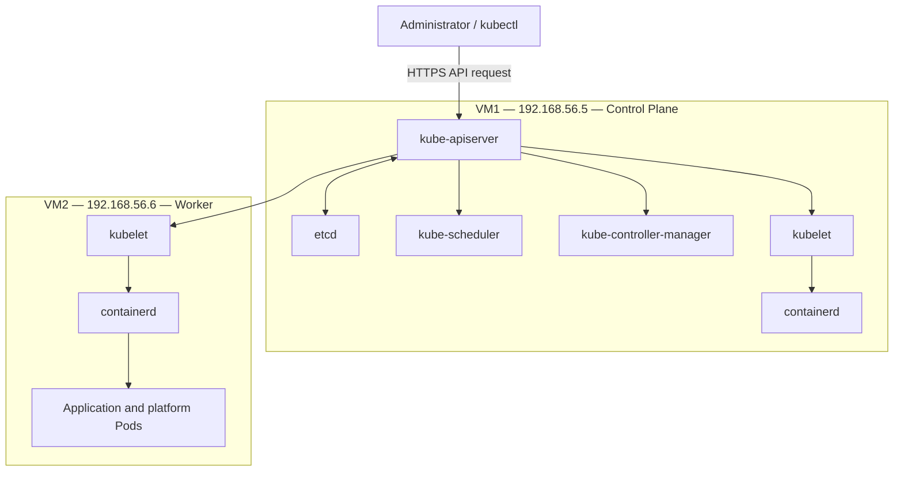

# Kubernetes Two-Node Lab on VirtualBox


> **Latest verified checkpoint: November 14, 2026.** The two-node kubeadm cluster was upgraded from Kubernetes `v1.35.9` to `v1.36.6`. VM1 and VM2 were both `Ready`; the final captured pod output showed application, system, monitoring, and observability workloads running.

This README documents the current two-node lab. It distinguishes recorded command output from reusable examples. Credentials, tokens, certificate keys, and private keys are intentionally omitted.

## Table of contents

1. [Overview](#1-overview)
2. [Architecture](#2-architecture)
3. [Environment](#3-environment)
4. [Kubernetes components](#4-kubernetes-components)
5. [Cluster installation vs kubectl installation](#5-cluster-installation-vs-kubectl-installation)
6. [Networking](#6-networking)
7. [Initial setup workflow](#7-initial-setup-workflow)
8. [Administration and kubeconfig](#8-administration-and-kubeconfig)
9. [Workloads and platform services](#9-workloads-and-platform-services)
10. [Pre-upgrade backups](#10-pre-upgrade-backups)
11. [Upgrade v1.35.9 to v1.36.6](#11-upgrade-v1359-to-v1366)
12. [Final validation and outputs](#12-final-validation-and-outputs)
13. [Troubleshooting](#13-troubleshooting)
14. [Command reference](#14-command-reference)
15. [Operational notes](#15-operational-notes)
16. [Separate historical three-control-plane lab](#16-separate-historical-three-control-plane-lab)
17. [Documentation boundaries](#17-documentation-boundaries)

---

## 1. Overview

The lab runs Kubernetes on two Ubuntu virtual machines hosted by an Apple Silicon MacBook Pro using Oracle VirtualBox.

- Kubernetes cluster lifecycle: `kubeadm`
- Container runtime: `containerd`
- Pod networking: Calico
- Control plane: VM1
- Worker: VM2
- Latest Kubernetes version: `v1.36.6`

### Objectives

- Establish a Kubernetes control plane and join a worker node.
- Understand `kubeadm`, `kubelet`, `kubectl`, API Server, `etcd`, and `containerd`.
- Deploy and operate application workloads.
- Run monitoring, logging, metrics, and observability components.
- Back up etcd, Kubernetes configuration, and selected hostPath data.
- Upgrade Kubernetes safely and validate the cluster.

### Latest result

| Check | Result |
|---|---|
| VM1 | `Ready`, control-plane, `v1.36.6` |
| VM2 | `Ready`, worker, `v1.36.6` |
| Application Pods | Running in final captured output |
| System Pods | Running in final captured output |
| Monitoring/observability Pods | Running in final captured output |
| Deployments | All deployments listed in final captured output were available |
| etcd snapshot | Created and verified |
| Configuration and monitoring archives | Created |

## 2. Architecture



| Node | IP | Role |
|---|---|---|
| VM1 | `192.168.56.5` | Control plane, etcd, kubelet, containerd, cluster administration |
| VM2 | `192.168.56.6` | Worker, kubelet, containerd, CNI networking, workloads |

**Topology warning:** This is a single-control-plane lab, not a highly available multi-control-plane cluster. If VM1 is unavailable, the Kubernetes API/control plane is unavailable. Workloads already running on VM2 may continue temporarily, but cluster management and scheduling are affected.

## 3. Environment

### Host

| Item | Value |
|---|---|
| Machine | MacBook Pro |
| CPU architecture | Apple Silicon / ARM64 |
| Physical memory | 16 GB |
| Hypervisor | Oracle VirtualBox |
| Guest OS | Ubuntu 26.04.1 LTS |

### Virtual machines

| VM | Role | IP | RAM | vCPU |
|---|---|---:|---:|---:|
| VM1 | Control plane | `192.168.56.5` | 5 GB | 3 |
| VM2 | Worker | `192.168.56.6` | 3 GB | 3 |

Total VM allocation is 8 GB. Leave sufficient memory for macOS and VirtualBox.

### Final software versions

| Component | VM1 | VM2 |
|---|---|---|
| Ubuntu | 26.04.1 LTS | 26.04.1 LTS |
| Architecture | ARM64 | ARM64 |
| Kubernetes | `v1.36.6` | `v1.36.6` |
| kubeadm package | `1.36.6-1.1` | `1.36.6-1.1` |
| kubelet package | `1.36.6-1.1` | `1.36.6-1.1` |
| kubectl package | `1.36.6-1.1` | `1.36.6-1.1` |
| Container runtime | `containerd://2.2.2` | `containerd://2.4.2` |

### VirtualBox host commands

Run on macOS:

```bash
VBoxManage list vms
VBoxManage list runningvms
VBoxManage showvminfo "VM1"
VBoxManage showvminfo "VM2"
VBoxManage showvminfo "VM1" | grep -E "Memory size|Number of CPUs"
VBoxManage showvminfo "VM2" | grep -E "Memory size|Number of CPUs"
```

Change resources only when the VM is fully powered off:

```bash
VBoxManage modifyvm "VM1" --memory 5120 --cpus 3
VBoxManage modifyvm "VM2" --memory 3072 --cpus 3
```

Start VMs:

```bash
VBoxManage startvm "VM1" --type gui
VBoxManage startvm "VM2" --type gui
```

SSH from macOS:

```bash
ssh admin@192.168.56.5
ssh admin@192.168.56.6
```

Graceful shutdown from Ubuntu:

```bash
sudo shutdown -h now
```

Or request ACPI shutdown from macOS:

```bash
VBoxManage controlvm "VM1" acpipowerbutton
VBoxManage controlvm "VM2" acpipowerbutton
```

## 4. Kubernetes components

These are different tools and processes.

| Component | Runs where | Type | Purpose |
|---|---|---|---|
| `kube-apiserver` | Control plane | Control-plane component | Exposes the Kubernetes API |
| `etcd` | Control plane | Key-value database | Stores cluster state |
| `kube-scheduler` | Control plane | Control-plane component | Selects a node for each newly scheduled Pod |
| `kube-controller-manager` | Control plane | Control-plane component | Runs controllers that reconcile desired and actual state |
| `kubelet` | Every node | Linux service / node agent | Ensures assigned Pods are running and reports status |
| `kube-proxy` | Every node in this lab | Node networking component | Implements Service networking rules |
| `containerd` | Every node | Container runtime | Pulls images and runs containers |
| Calico / CNI | Cluster nodes | Pod networking | Provides Pod networking |
| `kubectl` | Admin workstation or VM | CLI client | Sends API requests to manage the cluster |
| `kubeadm` | Nodes where lifecycle commands run | Cluster lifecycle tool | Initializes, joins, and upgrades Kubernetes |

### kubelet

`kubelet` is a service running on every node. It communicates with the API Server and works with the container runtime to keep Pods assigned to that node running.

```bash
sudo systemctl status kubelet --no-pager
sudo systemctl is-active kubelet
ps -ef | grep '[k]ubelet'
sudo journalctl -u kubelet -n 100 --no-pager
```

### kubectl

`kubectl` is a command-line client, not a node service. It can be installed on a Mac, Linux workstation, or VM. It needs a kubeconfig, credentials, authorization, and network access to the API Server.

```bash
kubectl version --client
kubectl get nodes
kubectl get pods -A
```

### kubeadm

`kubeadm` is used for cluster lifecycle operations:

```bash
kubeadm version -o short
sudo kubeadm upgrade plan
```

### containerd

`containerd` is the container runtime used by kubelet:

```bash
sudo systemctl status containerd --no-pager
sudo crictl ps -a
sudo crictl images
```

### How a Pod gets created

1. Administrator runs `kubectl apply -f app.yaml`.
2. `kubectl` sends an HTTPS request to the API Server.
3. API Server validates the request and stores cluster state in etcd.
4. Scheduler selects a suitable node.
5. The selected node's kubelet observes the Pod assignment.
6. kubelet asks containerd to pull the image and start the containers.
7. kubelet reports Pod and node status to the API Server.

## 5. Cluster installation vs kubectl installation

These are separate activities.

### Kubernetes cluster installation

This establishes the Kubernetes environment: control-plane components, node agents, runtime integration, networking, and node membership. In this lab, `kubeadm` was used to initialize and manage the cluster. `kubelet` runs on both nodes and `containerd` runs containers on both nodes.

### kubectl installation

This installs only the client executable. It does not create a cluster. To manage a cluster, kubectl needs a kubeconfig with a reachable API endpoint and valid credentials.

### Client version vs server version

```bash
kubectl version --client
kubectl version
kubectl get nodes -o wide
```

- **Client Version:** the kubectl binary being executed.
- **Server Version:** the Kubernetes API Server version.
- **Node version:** kubelet version reported for each node.

At the final checkpoint all were aligned at `v1.36.6`.

## 6. Networking

| Network item | Value |
|---|---|
| Host-only subnet | `192.168.56.0/24` |
| VM1 | `192.168.56.5` |
| VM2 | `192.168.56.6` |
| Pod CNI | Calico |
| Pod CIDR | `192.168.0.0/16` |
| Service CIDR | `10.96.0.0/12` |

**Network design concern:** the Pod CIDR `192.168.0.0/16` overlaps the host-only subnet `192.168.56.0/24`. The existing cluster was running with this configuration, but a future rebuild should choose non-overlapping node, Pod, Service, VPN, and LAN ranges. Do not change live CIDRs casually.

Validate Calico and nodes:

```bash
kubectl get pods -n kube-system -o wide
kubectl get pods -n kube-system -o wide | grep -i calico
kubectl get nodes -o wide
kubectl describe node vm1
kubectl describe node vm2
```

Check DNS and API readiness:

```bash
kubectl get pods -n kube-system | grep -i coredns
kubectl get svc -n kube-system
kubectl get --raw='/readyz'
kubectl get --raw='/readyz?verbose'
kubectl cluster-info
```

## 7. Initial setup workflow

The lab was created with kubeadm on Ubuntu VMs. The precise original bootstrap transcript was not present in the retrievable conversation record. Therefore, the commands below are a documented workflow/template, not a claim that every command and response below was captured verbatim from the original setup.

### 7.1 Prepare both nodes

```bash
sudo apt-get update
sudo apt-get install -y ca-certificates curl gpg apt-transport-https
free -h
lsb_release -a
uname -m
uname -r
```

Check swap:

```bash
sudo swapoff -a
swapon --show
free -h
sudo sed -n '1,200p' /etc/fstab
```

Inspect `/etc/fstab` and disable only the actual swap entry if configured persistently. Do not blindly edit unrelated entries.

### 7.2 Runtime checks

The cluster uses containerd:

```bash
containerd --version
sudo systemctl enable --now containerd
sudo systemctl status containerd --no-pager
sudo crictl info
```

The exact initial containerd installation/configuration transcript was not present in the retrieved record. Use the official procedure appropriate to the Ubuntu and Kubernetes versions when rebuilding.

### 7.3 Kubernetes packages and repository

The apt source file used during the upgrade was:

```text
/etc/apt/sources.list.d/kubernetes.sources
```

The repository was changed to the v1.36 channel during the upgrade. For a new installation, select the intended supported minor release and follow its matching package repository instructions.

### 7.4 Initialize the control plane

VM1 was established as the control-plane node. This is a kubeadm initialization template based on the recorded node and CIDR details; the exact original command was not available in the retrievable transcript:

```bash
sudo kubeadm init \
  --apiserver-advertise-address=192.168.56.5 \
  --pod-network-cidr=192.168.0.0/16 \
  --service-cidr=10.96.0.0/12
```

**Do not rerun `kubeadm init` on the existing cluster.** It is for creating a new cluster.

### 7.5 Configure administrator kubectl on VM1

Standard kubeadm administrator kubeconfig setup:

```bash
mkdir -p "$HOME/.kube"
sudo cp -i /etc/kubernetes/admin.conf "$HOME/.kube/config"
sudo chown "$(id -u):$(id -g)" "$HOME/.kube/config"
chmod 600 "$HOME/.kube/config"
```

Validate:

```bash
kubectl get nodes -o wide
kubectl get pods -A
kubectl cluster-info
```

### 7.6 Install CNI

Calico was used for Pod networking. Calico `v3.31.3` was recorded in the earlier lab checkpoint. After applying the chosen Calico manifest/chart, validate:

```bash
kubectl get pods -n kube-system -o wide
kubectl get nodes -o wide
```

A node may remain `NotReady` until the CNI is installed and healthy.

### 7.7 Join VM2 as worker

Generate a fresh join command on VM1:

```bash
sudo kubeadm token create --print-join-command
```

The actual generated token and CA hash are unique/temporary and must not be published. A worker join command has this general form:

```bash
sudo kubeadm join <CONTROL_PLANE_ENDPOINT>:6443 \
  --token <BOOTSTRAP_TOKEN> \
  --discovery-token-ca-cert-hash sha256:<CA_CERT_HASH>
```

Run the generated full command on VM2. The exact original join command was not retained in the accessible transcript.

Validate from VM1:

```bash
kubectl get nodes -o wide
kubectl get pods -A -o wide
```

## 8. Administration and kubeconfig

Use VM1 for cluster-wide administration because its administrator kubeconfig successfully queried both nodes after the upgrade.

```bash
ssh admin@192.168.56.5
kubectl get nodes -o wide
kubectl get pods -A
```

Standard kubeadm kubeconfig paths:

```text
/etc/kubernetes/admin.conf
$HOME/.kube/config
/var/lib/kubelet/kubelet.conf
```

The kubelet kubeconfig is not a cluster-admin kubeconfig. Do not use worker kubelet credentials for cluster administration.

### VM2 kubectl permission issue

After the upgrade, a local kubectl command on VM2 failed with:

```text
Error in configuration:
* unable to read client-cert /var/lib/kubelet/pki/kubelet-client-current.pem for default-auth due to open ... permission denied
* unable to read client-key /var/lib/kubelet/pki/kubelet-client-current.pem ... permission denied
```

This was a local kubeconfig/client-certificate access issue on VM2, not evidence of a cluster upgrade failure. VM1 successfully queried both nodes and all workloads.

Safe inspection commands on VM2:

```bash
echo "$KUBECONFIG"
kubectl config current-context
kubectl config view --minify
```

Do not print/share private keys, tokens, or credential-bearing kubeconfig content. Use VM1's administrator kubeconfig for cluster-wide commands.

## 9. Workloads and platform services

The final captured pod output on November 14 showed these workload categories/components.

### Application workloads

- `app-123-lob` — Flask application
- `app-143-lob` — Flask application
- `swaroopa-lob` — FastAPI RBAC test workload
- `swaroopa-lob` — Nginx RBAC test workload

### Monitoring and metrics

- Prometheus
- Grafana
- Alertmanager
- Fluentd
- kube-state-metrics
- node-exporter on both nodes
- metrics-server

### Observability and tracing

- Jaeger
- OpenTelemetry Collector
- trace-generator

### Kubernetes system components

- Calico controllers
- Calico node Pods on both nodes
- CoreDNS
- etcd
- kube-apiserver
- kube-controller-manager
- kube-scheduler
- kube-proxy on both nodes
- local-path-storage provisioner

Validate workloads:

```bash
kubectl get pods -A
kubectl get pods -A -o wide
kubectl get deployments -A
kubectl get services -A
kubectl get events -A --sort-by=.metadata.creationTimestamp
```

Inspect a workload:

```bash
kubectl describe pod <POD_NAME> -n <NAMESPACE>
kubectl logs <POD_NAME> -n <NAMESPACE>
kubectl get deployment <DEPLOYMENT_NAME> -n <NAMESPACE>
```

Use the actual Service/Ingress configuration to test application access. Exact URLs and endpoints were not captured in the latest upgrade transcript and are not invented here.

## 10. Pre-upgrade backups

Backups were created on November 14, 2026. VM1 backup directory:

```text
/home/admin/kube-backup/
```

### 10.1 etcd snapshot

The host did not have etcdctl installed:

```bash
command -v etcdctl
```

The command returned no path. The etcd container was found with:

```bash
sudo crictl ps | grep etcd
```

Observed container:

```text
Container ID: bf0e7acb8a817
Container name: etcd-vm1
```

Check the bundled etcdctl:

```bash
sudo crictl exec bf0e7acb8a817 etcdctl version
```

Observed:

```text
etcdctl version: 3.6.6
API version: 3.6
```

The minimal etcd container did not provide a shell. The snapshot was therefore created directly through `crictl exec`, writing into the hostPath-mounted etcd data directory:

```bash
sudo crictl exec bf0e7acb8a817 etcdctl \
  --endpoints=https://127.0.0.1:2379 \
  --cacert=/etc/kubernetes/pki/etcd/ca.crt \
  --cert=/etc/kubernetes/pki/etcd/healthcheck-client.crt \
  --key=/etc/kubernetes/pki/etcd/healthcheck-client.key \
  snapshot save /var/lib/etcd/etcd-backup.db
```

Copy to the backup directory and secure it:

```bash
sudo cp /var/lib/etcd/etcd-backup.db /home/admin/kube-backup/etcd-backup.db
sudo chown admin:admin /home/admin/kube-backup/etcd-backup.db
chmod 600 /home/admin/kube-backup/etcd-backup.db
ls -lh /home/admin/kube-backup/etcd-backup.db
```

The snapshot was approximately 9.8 MB.

`etcdctl snapshot status` was not available in the installed etcdctl 3.6.6. Verification used `etcdutl`:

```bash
sudo crictl exec bf0e7acb8a817 \
  etcdutl snapshot status /var/lib/etcd/etcd-backup.db --write-out=table
```

Observed output:

```text
HASH       REVISION TOTAL KEYS TOTAL SIZE VERSION
7fcf7509   78839    526        10 MB      3.6.0
```

Copy the snapshot from VM1 to the Mac host:

```bash
scp admin@192.168.56.5:/home/admin/kube-backup/etcd-backup.db .
```

The user confirmed the transfer completed and the file appeared in the Mac terminal's current working directory.

### 10.2 Kubernetes configuration archive

On VM1:

```bash
sudo tar -czf /home/admin/kube-backup/kubernetes-config-$(date +%F).tar.gz \
  /etc/kubernetes \
  /var/lib/kubelet/config.yaml \
  /etc/containerd/config.toml 2>/dev/null

sudo chown admin:admin /home/admin/kube-backup/kubernetes-config-$(date +%F).tar.gz
chmod 600 /home/admin/kube-backup/kubernetes-config-$(date +%F).tar.gz
ls -lh /home/admin/kube-backup/kubernetes-config-$(date +%F).tar.gz
```

Created:

```text
/home/admin/kube-backup/kubernetes-config-2026-11-14.tar.gz
```

Reported size: 39,091 bytes.

### 10.3 PV/PVC inventory

```bash
kubectl get pv,pvc -A
```

Observed:

```text
No resources found
```

No Kubernetes PV/PVC resources were listed at that checkpoint. Monitoring data was stored in hostPath directories.

### 10.4 VM1 monitoring and Fluentd archive

Observed directories:

```text
/var/lib/k8s-monitoring/grafana
/var/lib/k8s-monitoring/prometheus
/var/lib/fluentd
```

On VM1:

```bash
sudo tar -czf /home/admin/kube-backup/monitoring-vm1-$(date +%F).tar.gz \
  /var/lib/k8s-monitoring/grafana \
  /var/lib/k8s-monitoring/prometheus \
  /var/lib/fluentd

sudo chown admin:admin /home/admin/kube-backup/monitoring-vm1-$(date +%F).tar.gz
ls -lh /home/admin/kube-backup/monitoring-vm1-$(date +%F).tar.gz
```

Created:

```text
/home/admin/kube-backup/monitoring-vm1-2026-11-14.tar.gz
```

Reported size: approximately 49 MB.

### 10.5 VM2 Fluentd archive

On VM2:

```bash
sudo tar -czf /home/admin/fluentd-state-vm2-$(date +%F).tar.gz \
  /var/lib/fluentd

sudo chown admin:admin /home/admin/fluentd-state-vm2-$(date +%F).tar.gz
ls -lh /home/admin/fluentd-state-vm2-$(date +%F).tar.gz
```

Created:

```text
/home/admin/fluentd-state-vm2-2026-11-14.tar.gz
```

Reported size: approximately 1.4 MB.

The tar warning `Removing leading '/' from member names` is normal and does not indicate failure.

### 10.6 Backup inventory and limitations

| Backup | File | Reported size/status |
|---|---|---:|
| etcd | `etcd-backup.db` | ~9.8 MB; snapshot verified |
| Kubernetes config | `kubernetes-config-2026-11-14.tar.gz` | 39,091 bytes |
| VM1 monitoring | `monitoring-vm1-2026-11-14.tar.gz` | ~49 MB |
| VM2 Fluentd | `fluentd-state-vm2-2026-11-14.tar.gz` | ~1.4 MB |

The etcd snapshot was copied to the Mac host. The user confirmed backup/transfer steps were completed.

**Scope limitation:** These backups cover etcd, Kubernetes configuration, Grafana/Prometheus hostPath data, and Fluentd hostPath data. They do not prove that application databases or all application data were backed up. `emptyDir` data is ephemeral and is not protected by these archives.

## 11. Upgrade v1.35.9 to v1.36.6

**Date:** November 14, 2026  
**Path:** `v1.35.9` → `v1.36.6`  
**Order:** Control plane VM1 first, then worker VM2.

### 11.1 Repository source

The active apt source was:

```text
/etc/apt/sources.list.d/kubernetes.sources
```

An earlier attempt to edit a `.list` file did not affect the active source. The actual `.sources` file was then updated on both nodes.

### 11.2 Change repository to v1.36

Run on both VM1 and VM2:

```bash
sudo sed -i 's|stable:/v1.35/deb/|stable:/v1.36/deb/|' \
  /etc/apt/sources.list.d/kubernetes.sources
sudo apt-get update
```

Check available versions:

```bash
apt-cache madison kubeadm
apt-cache madison kubelet
apt-cache madison kubectl
```

The selected package version was `1.36.6-1.1`.

### 11.3 Upgrade kubeadm on VM1

```bash
sudo apt-mark unhold kubeadm
sudo apt-get install -y kubeadm=1.36.6-1.1
sudo apt-mark hold kubeadm
kubeadm version -o short
sudo kubeadm upgrade plan v1.36.6
```

Observed version:

```text
Kubernetes v1.36.6
```

The upgrade plan identified target Kubernetes `v1.36.6` and CoreDNS target `v1.14.2`. The captured plan did not require a manual configuration-group upgrade.

### 11.4 Upgrade the control plane on VM1

Run on the first control-plane node only:

```bash
sudo kubeadm upgrade apply v1.36.6 -y
```

The command completed successfully. The output confirmed updates to etcd, kube-apiserver, kube-controller-manager, kube-scheduler, kubeconfig files, kubelet configuration, CoreDNS, and kube-proxy.

Immediately after this step, the API Server reported `v1.36.6`, while node versions still showed `v1.35.9` until kubelet packages were upgraded. This was the intermediate staged-upgrade state.

### 11.5 Upgrade kubelet and kubectl on VM1

```bash
sudo apt-mark unhold kubelet kubectl
sudo apt-get install -y kubelet=1.36.6-1.1 kubectl=1.36.6-1.1
sudo apt-mark hold kubelet kubectl
sudo systemctl daemon-reload
sudo systemctl restart kubelet
kubelet --version
kubectl version --client
kubectl get nodes -o wide
```

Observed:

```text
Kubernetes v1.36.6
Client Version: v1.36.6
```

VM1 reported `v1.36.6` and `Ready`; VM2 was still `v1.35.9` at this intermediate point.

### 11.6 Upgrade kubeadm, kubelet, and kubectl on VM2

Run on VM2:

```bash
sudo apt-mark unhold kubeadm
sudo apt-get install -y kubeadm=1.36.6-1.1
sudo apt-mark hold kubeadm
kubeadm version -o short
sudo kubeadm upgrade node

sudo apt-mark unhold kubelet kubectl
sudo apt-get install -y kubelet=1.36.6-1.1 kubectl=1.36.6-1.1
sudo apt-mark hold kubelet kubectl

sudo systemctl daemon-reload
sudo systemctl restart kubelet
kubelet --version
kubectl version --client
```

Observed final local version output on VM2:

```text
Kubernetes v1.36.6
Client Version: v1.36.6
```

### 11.7 Final node verification from VM1

```bash
kubectl get nodes -o wide
```

Observed final output:

```text
NAME   STATUS   ROLES           VERSION   INTERNAL-IP    OS-IMAGE             KERNEL-VERSION       CONTAINER-RUNTIME
vm1    Ready    control-plane   v1.36.6   192.168.56.5   Ubuntu 26.04.1 LTS   7.0.0-42-generic     containerd://2.2.2
vm2    Ready    <none>          v1.36.6   192.168.56.6   Ubuntu 26.04.1 LTS   7.0.0-38-generic     containerd://2.4.2
```

Both nodes were `Ready` and reported `v1.36.6`.

## 12. Final validation and outputs

All final cluster-wide checks below were run from VM1.

### Nodes

```bash
kubectl get nodes -o wide
```

Observed: VM1 and VM2 both `Ready`, both at `v1.36.6`.

### Pods

```bash
kubectl get pods -A
```

The captured final output showed:
- Application Pods Running and Ready.
- Calico Pods Running.
- CoreDNS `2/2`.
- etcd, API Server, controller manager, scheduler, and kube-proxy running.
- Monitoring Pods running.
- Observability Pods running.
- Fluentd Pods running on both nodes.
- RBAC test Pods running.

### Deployments

```bash
kubectl get deployments -A
```

All deployments listed in the captured final output were available. A complete verbatim deployment table was not present in the latest transcript, so no replica counts are fabricated.

### Additional validation commands

```bash
kubectl get nodes -o wide
kubectl get pods -A -o wide
kubectl get deployments -A
kubectl get services -A
kubectl get events -A --sort-by=.metadata.creationTimestamp
kubectl get --raw='/readyz'
kubectl get pods -n kube-system -o wide
kubectl get pods -n kube-system | grep -i coredns
kubectl get pods -n kube-system | grep -i calico
```

Validate monitoring and observability:
- Confirm Prometheus targets are healthy in the Prometheus UI.
- Confirm Grafana dashboards can query Prometheus.
- Confirm Fluentd is collecting and forwarding logs.
- Confirm Jaeger and OpenTelemetry Collector are receiving traces.

Exact UI URLs and application endpoints were not captured in the latest upgrade transcript.

## 13. Troubleshooting

### 13.1 VM2 kubectl permission denied

**Observed error:**

```text
unable to read client-cert /var/lib/kubelet/pki/kubelet-client-current.pem
permission denied
```

**Cause/context:** The local kubeconfig selected on VM2 referenced the kubelet client certificate, which was not readable by the invoking account. This was a local kubeconfig/certificate access issue, not a cluster upgrade failure.

**Resolution/workaround:** Use VM1's administrator kubeconfig for cluster-wide commands. Do not copy administrator private keys to the worker unnecessarily.

### 13.2 Repository file mismatch

The attempted `.list` file was not the active apt source. The active file was:

```text
/etc/apt/sources.list.d/kubernetes.sources
```

Edit the actual `.sources` file and run `sudo apt-get update`.

### 13.3 etcdctl missing on host

`command -v etcdctl` returned no path. Use the etcd container's bundled tools through `crictl exec`:

```bash
sudo crictl ps | grep etcd
sudo crictl exec <ETCD_CONTAINER_ID> etcdctl version
```

### 13.4 No shell inside etcd container

The minimal etcd container did not provide a shell, so a shell-based `kubectl cp` approach was unsuccessful. The snapshot was created by directly executing `etcdctl` with `crictl exec`, writing into the hostPath-mounted etcd data directory.

### 13.5 etcdctl snapshot status unavailable

`etcdctl snapshot status` was unavailable in etcdctl 3.6.6. Use `etcdutl snapshot status`:

```bash
sudo crictl exec <ETCD_CONTAINER_ID> \
  etcdutl snapshot status /var/lib/etcd/etcd-backup.db --write-out=table
```

### 13.6 No PV/PVC resources

Observed:

```text
kubectl get pv,pvc -A
No resources found
```

Monitoring data was stored in hostPath directories and archived directly from the nodes.

### 13.7 Pending Pods / NotReady troubleshooting sequence

Use evidence-based triage; do not restart services as the first response.

```bash
kubectl get nodes -o wide
kubectl describe node <NODE_NAME>
kubectl get pods -A -o wide
kubectl describe pod <POD_NAME> -n <NAMESPACE>
kubectl get events -A --sort-by=.metadata.creationTimestamp
sudo systemctl status kubelet containerd --no-pager
sudo journalctl -u kubelet -n 100 --no-pager
sudo journalctl -u containerd -n 100 --no-pager
sudo crictl ps -a
```

Common event clues:
- `Insufficient cpu`
- `Insufficient memory`
- `unbound PersistentVolumeClaims`
- node selector or node affinity mismatch
- taints without matching tolerations
- image pull or registry authentication failures
- node not ready

Recommended diagnostic order:

1. Infrastructure and node health.
2. Control-plane/API and scheduler.
3. Pod lifecycle and scheduling.
4. Container runtime and image availability.
5. Service and EndpointSlice configuration.
6. Ingress and network path.

## 14. Command reference

### Cluster overview

```bash
kubectl get nodes -o wide
kubectl cluster-info
kubectl get --raw='/readyz'
kubectl get --raw='/readyz?verbose'
```

### Pods, deployments, services, events

```bash
kubectl get pods -A
kubectl get pods -A -o wide
kubectl get deployments -A
kubectl get services -A
kubectl get ingress -A
kubectl get events -A --sort-by=.metadata.creationTimestamp
```

### Inspect a workload

```bash
kubectl describe pod <POD_NAME> -n <NAMESPACE>
kubectl logs <POD_NAME> -n <NAMESPACE>
kubectl logs <POD_NAME> -n <NAMESPACE> --previous
kubectl describe deployment <DEPLOYMENT_NAME> -n <NAMESPACE>
```

### Node services and logs

```bash
sudo systemctl status kubelet --no-pager
sudo systemctl status containerd --no-pager
sudo journalctl -u kubelet -n 100 --no-pager
sudo journalctl -u containerd -n 100 --no-pager
sudo journalctl -u kubelet -f
```

### Container runtime

```bash
sudo crictl info
sudo crictl ps
sudo crictl ps -a
sudo crictl images
sudo crictl logs <CONTAINER_ID>
```

### Host resources

```bash
free -h
uptime
top
nproc
df -h
lsblk
sudo du -xh /var --max-depth=1 2>/dev/null | sort -h
sudo du -sh /var/lib/containerd
kubectl top nodes
kubectl top pods -A
```

`kubectl top` requires Metrics Server.

### Versions and certificates

```bash
kubeadm version -o short
kubelet --version
kubectl version --client
kubectl version
sudo kubeadm certs check-expiration
```

## 15. Operational notes

### Upgrade safety

- Back up etcd and important node/application data before upgrading.
- Review `kubeadm upgrade plan` before applying an upgrade.
- Upgrade the control plane first, then upgrade node packages using the kubeadm procedure.
- Keep kubeadm, kubelet, and kubectl on the intended versions.
- Validate nodes, system Pods, application Pods, deployments, DNS, CNI, monitoring, and log ingestion after each upgrade.
- A successful API Server upgrade does not mean every kubelet is already upgraded.

### Availability caveat

The November 14 upgrade did not drain nodes. Workloads remained running in the captured output, but this is not a zero-downtime guarantee. The lab has two nodes and many workloads may have one replica. Draining or rebooting a node can interrupt single-replica workloads or workloads that cannot be rescheduled.

### Backup caveat

An etcd snapshot protects Kubernetes API state. It is not a substitute for application database backups or persistent application data backups. Use application-consistent backup procedures for databases and application storage.

### Worker credentials

A worker kubelet identity is not a cluster administrator identity. Protect administrator kubeconfig credentials and use least privilege.

## 16. Separate historical three-control-plane lab

A separate earlier lab document described a different three-control-plane topology:

| Node | IP | Earlier role |
|---|---|---|
| VM1 | `192.168.56.2` | Control plane + etcd |
| VM2 | `192.168.56.3` | Control plane + etcd |
| VM3 | `192.168.56.4` | Control plane + etcd |
| Mac / HAProxy | `192.168.56.1:6443` | Shared API endpoint |

That separate exercise used Kubernetes `v1.35.9`, a three-member etcd cluster, and HAProxy. It is **not** the current two-node lab documented above. Its IPs, HAProxy configuration, join commands, and three-node etcd details must not be mixed into the current VM1 `192.168.56.5` / VM2 `192.168.56.6` setup.

## 17. Documentation boundaries

This README was assembled from the lab details and command outputs available in the conversation history and earlier lab notes.

- Exact outputs are included where they were captured.
- Where only a result was described, it is recorded without inventing a complete output table.
- Initial bootstrap commands are labeled as workflow templates when the original command transcript was unavailable.
- Secrets, tokens, certificate keys, and private keys are omitted.
- The historical three-control-plane exercise is explicitly separated from the current two-node cluster.

### Final verified checkpoint

```text
NAME   STATUS   ROLES           VERSION
vm1    Ready    control-plane   v1.36.6
vm2    Ready    <none>          v1.36.6
```

**Kubernetes v1.36.6 upgrade completed successfully on both nodes.**
